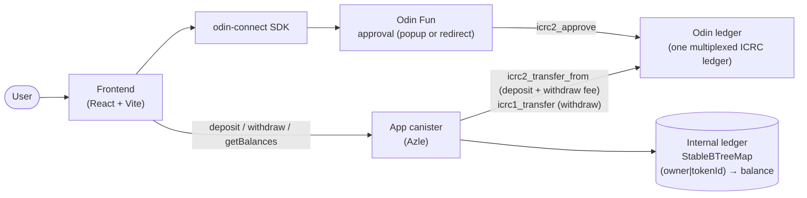

# odin-app-template

Reference canister app template for building on **Odin Fun**. Fork it, deploy it, and you have a working app with Odin Connect auth, deposit/withdraw flows, and an internal multi-token ledger.

## Stack

- **Canister**: [Azle](https://github.com/demergent-labs/azle) (TypeScript, Internet Computer)
- **Frontend**: React + TypeScript + Vite, [odin-connect](https://www.npmjs.com/package/odin-connect) SDK (2.x, state store — see [Odin Connect in the frontend](#odin-connect-in-the-frontend))
- **Tooling**: dfx, pnpm workspace

## Architecture



**Deposit**: the user approves the app canister as an ICRC-2 spender through the
Odin Fun approval page (a popup, or a full-page redirect in wallet in-app
browsers); once the approval's result is in the odin-connect state, the canister then pulls the approved funds itself
(`icrc2_transfer_from` on the Odin ledger) and credits the user's internal
balance. It is permissionless and self-verifying — a credit is only recorded for
funds that actually settled into the canister.

**Withdraw**: the user calls `withdraw`; the canister debits the internal
balance (persisted *before* the transfer await), pulls the BTC ledger fee from
the withdrawer (`icrc2_transfer_from`, see [Withdrawal fees](#withdrawal-fees)),
then sends the tokens back out on the Odin ledger (`icrc1_transfer`), refunding
the debit on failure.

## Odin Connect in the frontend

The frontend uses [odin-connect](https://www.npmjs.com/package/odin-connect)
**2.x**, which delivers every result — a connect, an ICRC-2 approval, a buy —
through **one state store** instead of only through the promise returned by the
call. That is what makes the app work inside wallet in-app browsers (OKX,
Xverse, …): there the SDK's default `mode: "auto"` navigates the tab to Odin
and back, the page reloads, and an awaited promise from before the reload never
returns. In normal browsers it uses popups; the app code is the same.

The pattern, as wired in this template:

1. **One instance per page load**, created at module level:
   [`src/odin/client.ts`](packages/frontend/src/odin/client.ts). Never one per
   render or per route.
2. **Render from state** with `useSyncExternalStore(odin.subscribe,
   odin.getState, odin.getServerState)`:
   [`src/odin/useOdinState.ts`](packages/frontend/src/odin/useOdinState.ts).
   `state` is `{ status, user, request }`; `status` is `"initializing"` until
   the stored session (and any returning redirect result) has been applied.
   [`OdinConnectProvider`](packages/frontend/src/odin/OdinConnectProvider.tsx)
   derives the UI's auth status from it
   ([`authStatus.ts`](packages/frontend/src/odin/authStatus.ts)) — there is no
   `restoreSession()` call.
3. **Start things from buttons, don't await them.** `odin.connect(…)` and
   `user.icrcApprove(…)` are fire-and-forget; their outcome arrives as
   `state.request` (`{ id, action, status, input, returnState?, error? }`,
   `status` one of `pending | success | rejected | failed | unverified`).
4. **React to `request` for the follow-up step.**
   [`DepositForm`](packages/frontend/src/components/DepositForm.tsx) and
   [`WithdrawForm`](packages/frontend/src/components/WithdrawForm.tsx) each have
   an effect that, when *their* `icrc_approve` request is `success`, calls the
   canister (`deposit` / `withdraw`). Rules they follow
   ([`approvalFlow.ts`](packages/frontend/src/odin/approvalFlow.ts)):
   - read call arguments from `request.input`, not from form state (gone after
     a redirect); put anything else the next step needs in `returnState`
     (JSON, bigints allowed) — withdraw carries the token + amount there, since
     its approval is for the BTC fee;
   - tag each flow's `returnState` (`{ flow: 'deposit' }`) so two flows that
     start the same action don't both react;
   - run a value-moving follow-up **at most once per `request.id`** (claimed
     before the call), because effects re-run and a settled request stays in
     state;
   - never treat `success` as proof: the canister's `icrc2_transfer_from` is the
     on-chain check of the allowance;
   - never call `connect()` automatically after a `rejected` / `unverified`
     connect — in redirect mode that loops the user back to Odin; show the
     Connect button (retry) instead.

Consequences for your fork:

- Code that reads `location.search` on load must read it after
  `await odin.ready()` (Odin returns to the page path without the query; the
  SDK restores it). The template's only such reader, `?lang=`, is consumed and
  stripped before any connect can start, so it is unaffected.
- If you add a Content-Security-Policy, `connect-src` must allow
  `https://api.odin.fun` — every connect is verified there.
- Do not add open-redirect pages (`/go?to=…`, `/redirect/<url>`) on your
  origin: redirect mode with `requires_api` / `requires_delegation` relies on
  Odin only returning to your own pages.
- To test the redirect path in a desktop browser, run `odin.mode = "redirect"`
  in the console (or construct with `mode: "redirect"` temporarily). Use
  `https://` or `http://localhost`.

Upgrading an older fork (odin-connect 1.6/1.7)? Follow the SDK's
[migration guide](https://github.com/Toniq-Labs/odin-connect/blob/main/MIGRATION-2.0.md)
(shipped in the package as `node_modules/odin-connect/MIGRATION-2.0.md`) and the
[readme](https://github.com/Toniq-Labs/odin-connect#readme) ("State and
sessions", "Wallet in-app browsers").

## Verifying logins on a backend (optional)

The template has no backend, and the app canister does not need one to know
who is calling: the IC authenticates every call, so `msgCaller()` is already
the user's principal. You only need this section if you add an **off-chain
service**, such as an API, bot or admin tool, that must know which Odin user
is calling it. A principal sent by the browser proves nothing on its own.

[odin-auth-verify](https://www.npmjs.com/package/odin-auth-verify) verifies an
Odin Connect login on a Node.js server. The browser signs a short login
message with its Odin Connect session key and sends it with the delegation
chain. The server checks the chain and the signature and gets back the user's
principal, the same one the canister sees as caller.

> **Pre-release:** the package is at `0.0.4` and its API may change before
> `0.1.0`. Pin the exact version (`"odin-auth-verify": "0.0.4"`).

```sh
npm install odin-auth-verify@0.0.4 @icp-sdk/core   # Node.js 22+
```

**Browser.** Connect with `requires_delegation: true` and
`targets: [APP_CANISTER_ID]`, as this template already does in
[`OdinConnectProvider`](packages/frontend/src/odin/OdinConnectProvider.tsx).
Without a delegation, `user.getIdentity()` is `null` and there is nothing to
sign. Sign `prefix + timestamp` with the identity:

```ts
const LOGIN_MESSAGE_PREFIX = 'my-app-login:v1\n'; // unique to your app

const identity = user.getIdentity()!;
const timestamp = Date.now().toString();
const signature = await identity.sign(
    new TextEncoder().encode(`${LOGIN_MESSAGE_PREFIX}${timestamp}`),
);
const body = {
    delegation: JSON.stringify(identity.getDelegation().toJSON()),
    timestamp,
    signature: btoa(String.fromCharCode(...new Uint8Array(signature))),
};
// POST body to your backend
```

**Server.** Build the verifier once at startup and call it per request:

```ts
import {
    OdinLoginError,
    createMemoryReplayGuard,
    createOdinLoginVerifier,
} from 'odin-auth-verify';

const verifyLogin = createOdinLoginVerifier({
    appCanisterId: process.env.APP_CANISTER_ID!, // same as VITE_APP_CANISTER_ID
    messagePrefix: 'my-app-login:v1\n', // same as the browser
    replayGuard: createMemoryReplayGuard(), // one process only
});

try {
    const { principal } = await verifyLogin(body);
    // issue your own session (cookie, JWT) for `principal`
} catch (error) {
    if (error instanceof OdinLoginError) {
        // respond 401; error.code says why (REPLAYED, NOT_SCOPED_TO_APP, …)
    }
    throw error;
}
```

It rejects a login that is older than 5 minutes, expired, scoped to a
different canister, badly signed, signed for another app's prefix, or already
used. Things to get right in a fork:

- `appCanisterId` must be **your** canister. A delegation Odin issued to
  another app is then rejected even if it is valid.
- `messagePrefix` must be unique to your app and identical on both sides. It
  must not be empty or end with a digit.
- `createMemoryReplayGuard()` only works for one server process. With several
  instances, implement `ReplayGuard` on a shared store (Redis
  `SET key 1 NX PXAT expiresAtMs`, or a table with a unique key).
- Canister signatures verify against the IC mainnet root key. Only when Odin
  itself runs on a local replica do you pass `rootKey` to
  `createOdinLoginVerifier`. Take it from startup configuration, never from the
  request.

A runnable version is in [`examples/backend-login`](examples/backend-login):
a `node:http` server with `POST /login`, plus a dependency-free
`login-client.ts` you can copy into the frontend. See the
[package README](https://github.com/Toniq-Labs/odin-auth-verify#readme) for
error codes and the lower-level verifiers.

## Layout

```
packages/
  canister/   # Azle canister — internal multi-token ledger
  frontend/   # Vite + React app — Odin Connect auth + deposit/withdraw UI
examples/
  backend-login/  # optional Node backend verifying Odin logins (not in the workspace)
dfx.json      # canister (azle) + frontend (asset) canister config
```

## Prerequisites

- [Node.js](https://nodejs.org) 22+ (see `.nvmrc`)
- [pnpm](https://pnpm.io) 10+
- [dfx](https://internetcomputer.org/docs/current/developer-docs/getting-started/install) 0.31+
- [Rust](https://www.rust-lang.org/tools/install) + `wasm32-unknown-unknown` target (required by Azle)

```sh
rustup target add wasm32-unknown-unknown
```

## Quick start

```sh
pnpm install          # install workspace deps (auto-installs the azle dfx extension if dfx is on PATH)
dfx start --clean --background
pnpm deploy:dev       # build + deploy the canister against the Odin dev ledger
dfx deploy frontend   # build + deploy the frontend asset canister
```

The canister takes the **Odin ledger** it holds funds on as a required init
argument (see [Odin ledger](#odin-ledger)). `pnpm deploy:dev` / `pnpm
deploy:prod` pass it for you; a bare `dfx deploy` prompts for it. The frontend
asset canister does not depend on the app canister in `dfx.json` (it gets the
canister id from `VITE_APP_CANISTER_ID`), so `dfx deploy frontend` never
redeploys the canister without its argument.

> If `pnpm install` ran before `dfx` was installed, register the azle dfx extension manually:
>
> ```sh
> pnpm --filter @odin-app/canister exec azle extension install
> ```

Frontend dev server:

```sh
pnpm dev:frontend
```

## Scripts

| Command                | Description                          |
| ---------------------- | ------------------------------------ |
| `pnpm build`           | Build all workspace packages         |
| `pnpm build:canister`  | Build the Azle canister              |
| `pnpm build:frontend`  | Build the frontend                   |
| `pnpm deploy:dev`      | Deploy the canister on the Odin dev ledger |
| `pnpm deploy:prod`     | Deploy the canister on the Odin prod/staging ledger |
| `pnpm dev:frontend`    | Start the Vite dev server            |
| `pnpm typecheck`       | Type-check all packages              |
| `pnpm test`            | Run unit tests (ledger, ledger id)   |

## Canister API

| Endpoint        | Kind   | Description                                                        |
| --------------- | ------ | ----------------------------------------------------------------- |
| `deposit`       | update | Pull pre-approved funds from the Odin ledger and credit the caller. |
| `withdraw`      | update | Debit the caller's balance and send tokens back via the Odin ledger. |
| `getBalance`    | query  | Caller's internal balance for one token.                          |
| `getBalances`   | query  | All of the caller's `(token, balance)` pairs.                     |
| `getOwner`      | query  | The configured owner principal, or empty if not yet initialized.  |
| `getOdinLedger` | update | The Odin ledger canister this canister holds funds on (certified). |
| `icrc28_trusted_origins` | update | [ICRC-28](https://github.com/dfinity/wg-identity-authentication) trusted origins — the web origins allowed to request signed calls. Odin Connect calls this before issuing a delegation and refuses auth if your app's origin is not listed. |

> **ICRC-28 / Odin Connect auth:** the trusted origins are configured in
> `TRUSTED_ORIGINS` in
> [`packages/canister/src/index.ts`](packages/canister/src/index.ts). Each entry
> must be a bare origin (`scheme://host[:port]`, no trailing slash, no path);
> https only, except `http://localhost` in dev. The signer does an exact string
> match. **Edit this list to your deployed frontend origin before going live** —
> a wrong or missing origin fails login silently. It must be `update` (not
> `query`): the signer issues a replicated call so the response is certified.

Tokens are identified by their **Odin token id** (text), not an ICRC ledger
principal — every Odin token shares one ledger and is addressed by subaccount
(`odin_token_pointer`). Balances are keyed by `(owner, tokenId)` and stored in
stable memory, so they survive upgrades.

### Odin ledger

Each Odin environment has its own ledger canister:

| Environment      | `VITE_ODIN_ENV`  | Ledger canister                 |
| ---------------- | ---------------- | ------------------------------- |
| dev              | `dev`            | `w5cxm-6iaaa-aaaaj-az4jq-cai`   |
| prod / staging   | `prod`, `staging`| `yspgd-ciaaa-aaaaj-a6rrq-cai`   |

The canister takes the ledger as its init argument,
`(record { ledger_id = principal "<ledger>" })`, and rejects any principal not
in the table above (`ODIN_LEDGER_IDS` in
[`odin_ledger.ts`](packages/canister/src/odin_ledger.ts)). The frontend's
`VITE_ODIN_ENV` **must match it** — otherwise users approve on one ledger while
the canister pulls from another, and deposits fail.

The ledger is **immutable after install**. Every internal balance is backed by
tokens held on that ledger, so switching ledgers would let withdrawals pay out
funds that were never deposited there. On upgrade, pass the same argument again
(`pnpm deploy:dev` / `pnpm deploy:prod` do this); an upgrade naming a different
ledger traps and the old code keeps running. To change environment, reinstall
(`dfx deploy canister --mode reinstall …`, which **wipes all balances** —
only on a canister holding no funds) or deploy a new canister.

**Upgrading a canister installed before the ledger became an init argument.**
Its ledger was a constant in `packages/canister/src/odin.ts`, and the canister
has no record of it, so its first upgrade records whatever ledger you pass —
**permanently**. Before upgrading, check `odin.ts` at the commit you actually
deployed (`git show <deployed-commit>:packages/canister/src/odin.ts`) and use
the matching script: `pnpm deploy:prod` for `yspgd-…`, `pnpm deploy:dev` for
`w5cxm-…`. Passing the wrong ledger leaves every balance unbacked, and the only
way out is a reinstall that wipes them. After the upgrade, confirm it with
`getOdinLedger` below.

Verify a deployed canister's ledger with:

```sh
dfx canister call canister getOdinLedger '()' --network ic
```

### Withdrawal fees

transfer. On withdraw the sender is the app canister, so the canister pays that
fee in BTC.

This template makes the **withdrawer pay** the fee — no maintainer-funded float,
not griefable. The flow:

1. On withdraw the frontend requests an ICRC-2 BTC approval (`icrcApprove`,
   token `"btc"`) for **2× the fee**.
2. `withdraw` pulls the fee from the caller's BTC (`icrc2_transfer_from`), then
   sends the tokens. The pulled BTC funds the outbound transfer's own fee, so on
   success the canister **nets zero BTC and needs no float**. If the token send
   fails after the fee pull, the fee is forfeited (not refunded — returning it
   would cost another BTC transfer), leaving the canister a small BTC surplus.

Why 2×: pulling BTC is itself a transfer, and the ledger charges the caller a
fee on that pull too (debited from `from`, per ICRC-2). So the withdrawer pays
the fee twice — once for the pull, once funding the send — and the approval must
cover both. See `ODIN_BTC_FEE` in
[`packages/canister/src/odin.ts`](packages/canister/src/odin.ts) and
[`packages/frontend/src/lib/fees.ts`](packages/frontend/src/lib/fees.ts).

> **Verify before mainnet:** `ODIN_BTC_FEE` is set to the documented 100 sats.
> Confirm it matches the live ledger fee — too low traps the first withdraw with
> `error 910`; too high leaves the canister a small BTC surplus.

## Deploy to mainnet

1. Make sure you have a cycles-funded identity (`dfx identity get-principal`,
   then fund it with cycles — see the
   [cycles docs](https://internetcomputer.org/docs/current/developer-docs/getting-started/cycles/cycles-wallet)).

2. Build and deploy to the IC:

   ```sh
   pnpm build                       # frontend dist + canister type check
   pnpm deploy:prod --network ic    # canister on the prod/staging ledger (or deploy:dev)
   dfx deploy frontend --network ic # frontend asset canister
   ```

3. The deploying principal is recorded as the **owner** (see `@init` in
   [`packages/canister/src/index.ts`](packages/canister/src/index.ts)) — a
   generic admin handle for any admin-gated endpoints you add later. Deposits are
   **not** owner-gated: `deposit` is permissionless and self-verifying (it pulls
   the caller's own pre-approved funds before crediting), so no trusted minter is
   needed.

4. Note the canister IDs printed on deploy; the frontend reads them from the
   generated `.env` (`output_env_file` in `dfx.json`).

5. **Set your trusted origins.** Edit `TRUSTED_ORIGINS` in
   [`packages/canister/src/index.ts`](packages/canister/src/index.ts) to the
   origin your frontend is served from (e.g. your asset-canister URL or custom
   domain), then redeploy. Odin Connect login fails until your origin is listed.
   Verify with:

   ```sh
   dfx canister call canister icrc28_trusted_origins '()' --network ic
   ```

6. **No canister BTC float needed** for withdrawals — the withdrawer pays the
   Odin ledger fee at withdraw time (see [Withdrawal fees](#withdrawal-fees)).
   Just confirm `ODIN_BTC_FEE` matches the live ledger fee before going live.

## How to extend

**Add support for a new token** — no code change needed. Tokens are identified
by their Odin token id (text); pass the id to `deposit` / `withdraw` /
`getBalance`. The ledger keys every balance by `(owner, tokenId)`, so new tokens
work out of the box.

**Add a new canister endpoint** — add a `@query` / `@update` method in
[`packages/canister/src/index.ts`](packages/canister/src/index.ts). ⚠️ Add code
*around* the hardened ledger core, never inside the `BEGIN/END HARDENED LEDGER
CORE` markers in
[`packages/canister/src/ledger.ts`](packages/canister/src/ledger.ts). See
[`CLAUDE.md`](CLAUDE.md) for the full guardrails.

**Frontend changes** — UI, components, and styling under
[`packages/frontend/src`](packages/frontend/src) are free to modify. Auth and
flows are built on the [odin-connect](https://www.npmjs.com/package/odin-connect)
SDK — render from its state, never from an awaited call (see
[Odin Connect in the frontend](#odin-connect-in-the-frontend)).

**Add an off-chain backend** — verify Odin logins with
[odin-auth-verify](https://www.npmjs.com/package/odin-auth-verify) instead of
trusting a principal sent by the browser. See
[Verifying logins on a backend](#verifying-logins-on-a-backend-optional) and
[`examples/backend-login`](examples/backend-login).

**Add a language (i18n)** — the frontend is localized with
[react-i18next](https://react.i18next.com/). English (`en`) is the default and
the source of truth for keys; Simplified Chinese (`zh`) ships alongside it.
Locale detection is `?lang=` query param → `localStorage` → browser language →
`en`, and the choice persists across reloads. To add a locale (e.g. Japanese,
`ja`):

1. Copy [`src/i18n/locales/en.json`](packages/frontend/src/i18n/locales/en.json)
   to `src/i18n/locales/ja.json` and translate the values (keep the keys).
2. In [`src/i18n/index.ts`](packages/frontend/src/i18n/index.ts): import the new
   catalog, add it to `resources`, and add `'ja'` to `SUPPORTED_LOCALES`.
3. Add a `language.ja` label to every locale catalog (the switcher labels each
   option with `t('language.<locale>')`).

`en.json` is the key source of truth: every other catalog is checked against it
at compile time (a missing or misspelled key fails `pnpm typecheck`), so keep
the key sets identical. The switcher in
[`src/components/LanguageSwitcher.tsx`](packages/frontend/src/components/LanguageSwitcher.tsx)
renders one option per `SUPPORTED_LOCALES` entry automatically.

**Share a language via URL (`?lang=`)** — opening the app with `?lang=zh` (or
`?lang=en`) applies that language as if the user had picked it in the switcher:
it is persisted to `localStorage` and the param is stripped from the URL so a
stale link can't override a later in-app choice. Regional variants map to their
base language (`zh-CN` → `zh`); unsupported values are ignored. See
[`src/i18n/locale.ts`](packages/frontend/src/i18n/locale.ts).

**Language in the Odin Connect pages** — the app forwards its active locale to
the [odin-connect](https://www.npmjs.com/package/odin-connect) SDK via its
runtime `lang` setter, on mount and whenever the user switches language, so
sign-in and canister-action pages (popup or redirect) open in the app's current
language without a reload. See
[`src/odin/OdinConnectProvider.tsx`](packages/frontend/src/odin/OdinConnectProvider.tsx).
